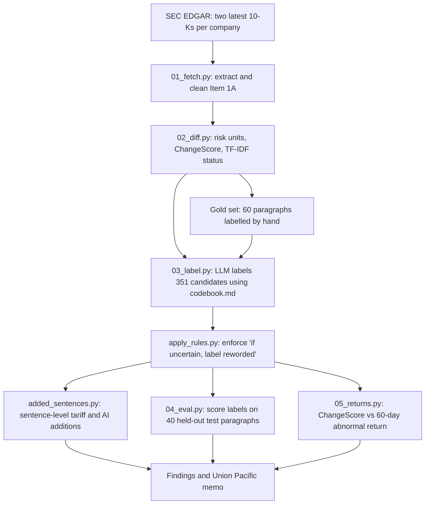

# Risk-Factor Change Tracker

This project compares the two most recent annual reports (Form 10-K) of 25 North American companies to find what changed in their "Risk Factors" sections, and separates new risks from rewording with TF-IDF similarity and an LLM following a written codebook. It checks the labels against hand-labelled paragraphs, counts language added at sentence level, tests for a link to stock returns, and ends with an analyst memo on Union Pacific.

## Key findings

1. **Most risk language is copied forward:** 80% of this year's risk paragraphs (1,408 of 1,759) closely match last year's, and of the 351 that changed, 54 (15%) were judged genuinely new, from 15 of the 25 companies.
2. **Mergers are the largest source of new risks:** 30 of the 54 are about mergers, acquisitions or divestitures, and 26 of those come from Union Pacific (18) and Norfolk Southern (8) describing their planned merger.
3. **Tariffs grew inside existing risks:** no company added a new tariff risk paragraph, but 59 new sentences mentioning tariffs appear across 15 of the 25 companies.
4. **AI appears both ways:** 9 companies wrote a genuinely new risk paragraph that mentions AI, and 19 of the 25 added at least one new sentence about AI.
5. **The LLM labels held up:** on 40 hand-labelled test paragraphs it found 6 of the 7 genuinely new risks with no false alarms (6 of 6), against 47% precision (7 of 15) for the text-similarity screen alone, and all 40 supporting quotes appear in the filing.

Source file and filter for each number: [FINDINGS.md](FINDINGS.md).

**Contents:** [Analyst memo](#analyst-memo-union-pacific) · [Objective](#objective) · [Data and scope](#data-and-scope) · [Method](#method) · [Evaluation](#evaluation) · [Results](#results) · [Conclusions](#conclusions) · [Limitations](#limitations) · [License](#license)

## Analyst memo: Union Pacific

Union Pacific was chosen on its disclosures, not its stock performance: it has the second-highest change score of the 25 companies (0.196) and the most genuinely new risks (20).

[Download PDF](output/memo.pdf) · Memo dated October 19, 2026

Memo text

### Union Pacific: what the risk factors added, and what they understate

**Bottom line.** UNP rewrote its Risk Factors more than all but one of 25 companies, almost entirely to describe one event: its proposed acquisition of Norfolk Southern. The filing understates who bears the regulatory risk, and tariffs are the one new risk already hurting results.

**What they added**
1. Regulatory approval. "In January 2026, the STB announced its finding that the major merger application filed by the Company and Norfolk Southern was incomplete, as a result of which the STB rejected the application without prejudice."
2. Merger debt. "We expect to incur significant new indebtedness in connection with the mergers." No amount is given.
3. Tariffs, added inside an otherwise unchanged paragraph on regulation. "Incremental import tariffs adversely affected demand for our services and increased our costs for purchased goods and services during fiscal year 2025 and may continue to do so in 2026."

**Why it matters**
- The regulatory downside is one-sided. Under the merger agreement (§7.3(b)(i)), UNP pays Norfolk Southern $2.5bn if regulators block the deal or impose conditions UNP won't accept. Item 1A spells out only the competing-offer case.
- Leverage resets. Borrowing most of the ~$20bn cash consideration would lift leverage well above today's level, and buybacks are already paused.
- Tariff damage sits in the segments. Group volumes rose 1%, but automotive shipments fell 4% for the year and international intermodal fell 24% in the second half.

**Questions for management**
1. Given the $2.5bn fee, which conditions would you treat as "materially burdensome"?
2. How will the ~$20bn be funded, and what leverage do you target at close?
3. How much of the 2025 automotive and intermodal decline came from tariffs?

**What would change my view**
- Heavy remedy requests in the November 18 opposition filings.
- Financing that relies more on cash than on new debt.
- Tariff weakness spreading into group volumes in 2026.

**Data note.** Sources: UNP 10-Ks (2025, 2026), the merger agreement, SEC XBRL data, and 2026 10-Qs and STB decisions. The 20 new paragraphs describe one event, not 20 separate risks; full method in the project repository.

---

## Objective

**Question:** when companies update their risk disclosures, what is actually new, and can it be separated reliably from rewording?

**Why it matters:** Item 1A is where a company tells investors what could hurt its business. Most of it carries forward each year, so real changes are easy to miss. Cohen, Malloy and Nguyen ("Lazy Prices", *Journal of Finance*, 2020) found that companies that change their filings go on to underperform, and that risk-factor changes carry information about future returns.

## Data and scope

- **Source:** Form 10-K filings from [SEC EDGAR](https://www.sec.gov/edgar), downloaded with [edgartools](https://github.com/dgunning/edgartools).
- **Filings:** the two most recent 10-Ks per company, 50 in total, excluding amendments.
- **Filing dates:** latest filings run from 2025-11-14 to 2026-07-15, prior filings from 2024-11-20 to 2025-07-17.
- **Companies:** 5 Canadian 10-K filers and 20 US peers.

| Ticker | Company | Industry group | Canadian 10-K filer |
|---|---|---|---|
| UNP | Union Pacific Corporation | Rail |  |
| CSX | CSX Corporation | Rail |  |
| NSC | Norfolk Southern Corporation | Rail |  |
| CP | Canadian Pacific Kansas City Limited | Rail | Yes |
| MCD | McDonald's Corporation | Restaurants |  |
| YUM | Yum! Brands, Inc. | Restaurants |  |
| DPZ | Domino's Pizza, Inc. | Restaurants |  |
| WEN | The Wendy's Company | Restaurants |  |
| CMG | Chipotle Mexican Grill, Inc. | Restaurants |  |
| SBUX | Starbucks Corporation | Restaurants |  |
| QSR | Restaurant Brands International Inc. | Restaurants | Yes |
| WM | Waste Management, Inc. | Waste |  |
| RSG | Republic Services, Inc. | Waste |  |
| WCN | Waste Connections, Inc. | Waste | Yes |
| NKE | NIKE, Inc. | Apparel |  |
| GAP | Gap Inc. | Apparel |  |
| UAA | Under Armour, Inc. | Apparel |  |
| VFC | V.F. Corporation | Apparel |  |
| LULU | lululemon athletica inc. | Apparel | Yes |
| AMZN | Amazon.com, Inc. | E-commerce/payments |  |
| EBAY | eBay Inc. | E-commerce/payments |  |
| ETSY | Etsy, Inc. | E-commerce/payments |  |
| PYPL | PayPal Holdings, Inc. | E-commerce/payments |  |
| XYZ | Block, Inc. | E-commerce/payments |  |
| SHOP | Shopify Inc. | E-commerce/payments | Yes |

## Method

1. **Fetch and clean (`01_fetch.py`).** Extracts Item 1A from each 10-K and removes page footers and page breaks that would look like changes.
2. **Risk units (`02_diff.py`).** Groups the text into risk units and excludes summary sections, so risks are not counted twice.
3. **ChangeScore (`02_diff.py`).** 1 minus the TF-IDF cosine similarity between a company's latest and prior Risk Factors. No LLM is involved.
4. **Status (`02_diff.py`).** Each latest unit is matched to its closest prior unit: `kept` at 0.80 or above, `modified` from 0.50 to below 0.80, `new` below 0.50. Prior units with no match of 0.50 or above are `deleted`.
5. **LLM labelling (`03_label.py`, `codebook.md`).** `new` and `modified` paragraphs go to `claude-sonnet-5-5` with the codebook and their three closest prior-year matches. It returns category, novelty, severity, AI mention and one supporting quote. `apply_rules.py` then enforces "if uncertain about novelty, label reworded", which changed 3 rows.
6. **Sentence-level analysis (`added_sentences.py`).** Catches sentences added inside `kept` paragraphs, which never reach the LLM. A sentence is "added" if its best prior match scores below 85 (rapidfuzz ratio).
7. **Evaluation (`04_eval.py`).** Scores the LLM against the hand labels on held-out paragraphs.
8. **Returns test (`05_returns.py`).** Abnormal return is the stock's return minus SPY over the 60 trading days after filing. Spearman correlation with ChangeScore is the primary test, and with new-risk count the secondary.

Each choice is logged in [DECISIONS.md](DECISIONS.md).

## Evaluation

The gold set is 60 hand-labelled paragraphs, split into 20 development and 40 test paragraphs before any LLM output existed. On the test set the LLM raised no false alarms and missed one new risk, while more than half of the TF-IDF flags were false alarms. All 40 of the LLM's supporting quotes were verified in code against the paragraph text.

| Method | Precision on new risks | Recall on new risks |
|---|---:|---:|
| LLM | 6/6 (100.0%) | 6/7 (85.7%) |
| TF-IDF only | 7/15 (46.7%) | 7/7 (100.0%) |

Full evaluation: [eval_report.md](pipeline/data/eval_report.md).

## Results

### ChangeScore ranking

Higher means more change. Latest and Prior are risk units per filing, New to Deleted are TF-IDF statuses, and Genuinely new is the final LLM label.

| # | Ticker | Score | Latest | Prior | New | Modified | Kept | Deleted | Genuinely new |
|---:|---|---:|---:|---:|---:|---:|---:|---:|---:|
| 1 | SBUX | 0.239 | 62 | 66 | 31 | 23 | 8 | 36 | 1 |
| 2 | UNP | 0.196 | 44 | 23 | 21 | 0 | 23 | 0 | 20 |
| 3 | EBAY | 0.134 | 95 | 102 | 23 | 42 | 30 | 33 | 1 |
| 4 | LULU | 0.128 | 70 | 71 | 12 | 9 | 49 | 12 | 2 |
| 5 | NSC | 0.123 | 47 | 41 | 9 | 0 | 38 | 3 | 8 |
| 6 | QSR | 0.072 | 55 | 62 | 0 | 5 | 50 | 6 | 0 |
| 7 | CMG | 0.071 | 43 | 45 | 5 | 2 | 36 | 7 | 2 |
| 8 | UAA | 0.065 | 62 | 63 | 3 | 6 | 53 | 5 | 1 |
| 9 | ETSY | 0.056 | 143 | 149 | 16 | 11 | 116 | 21 | 5 |
| 10 | WM | 0.052 | 75 | 89 | 1 | 19 | 55 | 11 | 0 |
| 11 | WEN | 0.050 | 59 | 56 | 3 | 11 | 45 | 2 | 1 |
| 12 | GAP | 0.046 | 66 | 65 | 5 | 8 | 53 | 4 | 2 |
| 13 | XYZ | 0.040 | 137 | 128 | 13 | 11 | 113 | 5 | 7 |
| 14 | YUM | 0.036 | 68 | 72 | 2 | 9 | 57 | 4 | 1 |
| 15 | VFC | 0.035 | 83 | 82 | 3 | 5 | 75 | 3 | 0 |
| 16 | PYPL | 0.033 | 72 | 72 | 3 | 4 | 65 | 3 | 1 |
| 17 | CP | 0.032 | 49 | 51 | 1 | 5 | 43 | 2 | 0 |
| 18 | SHOP | 0.031 | 115 | 119 | 2 | 2 | 111 | 6 | 1 |
| 19 | RSG | 0.028 | 54 | 54 | 1 | 2 | 51 | 1 | 0 |
| 20 | NKE | 0.027 | 77 | 78 | 0 | 5 | 72 | 1 | 1 |
| 21 | WCN | 0.021 | 75 | 78 | 0 | 3 | 72 | 2 | 0 |
| 22 | DPZ | 0.020 | 67 | 63 | 1 | 9 | 57 | 0 | 0 |
| 23 | MCD | 0.020 | 54 | 52 | 2 | 1 | 51 | 0 | 0 |
| 24 | CSX | 0.010 | 38 | 37 | 1 | 1 | 36 | 1 | 0 |
| 25 | AMZN | 0.005 | 49 | 49 | 0 | 0 | 49 | 0 | 0 |

A high score does not mean new risks: Starbucks ranks first, but most of its change is restructuring and rewording.

### New risks by category

| Category | Genuinely new | All candidates |
|---|---:|---:|
| M&A/transactions | 30 | 41 |
| AI/tech | 13 | 33 |
| credit/liquidity | 3 | 27 |
| regulation/legal | 3 | 87 |
| other | 4 | 84 |
| cyber/data privacy | 1 | 10 |
| tariffs/trade | 0 | 19 |
| competition | 0 | 23 |
| macro | 0 | 22 |
| not_a_risk | 0 | 5 |
| **Total** | **54** | **351** |

All candidates also counts paragraphs labelled `reworded` or `not_a_risk`.

### Tariff and AI sentences

A new mention is an added sentence whose closest prior sentence lacks the term. It marks a new sentence on the topic, not a first-ever disclosure.

| Theme | Added sentences mentioning it | New mentions | Companies with a new mention | New mentions inside `kept` paragraphs |
|---|---:|---:|---:|---:|
| Tariffs | 80 | 59 | 15 | 13 |
| AI | 143 | 109 | 19 | 35 |

Companies with no new mention are omitted below.

| Ticker | New tariff mentions | New AI mentions |
|---|---:|---:|
| LULU | 14 | 6 |
| EBAY | 9 | 13 |
| GAP | 8 | 7 |
| SBUX | 6 | 3 |
| UNP | 5 | 0 |
| UAA | 4 | 6 |
| ETSY | 3 | 18 |
| XYZ | 2 | 20 |
| YUM | 2 | 3 |
| QSR | 1 | 2 |
| VFC | 1 | 2 |
| CMG | 1 | 1 |
| WM | 1 | 1 |
| CP | 1 | 0 |
| PYPL | 1 | 0 |
| NKE | 0 | 6 |
| AMZN | 0 | 5 |
| MCD | 0 | 4 |
| RSG | 0 | 4 |
| SHOP | 0 | 4 |
| WCN | 0 | 2 |
| WEN | 0 | 2 |

### Returns test

All 25 companies had a complete 60-day window.

| Test | Spearman ρ | p-value | n |
|---|---:|---:|---:|
| ChangeScore vs abnormal return (primary) | 0.23 | 0.27 | 25 |
| Genuinely new risk count vs abnormal return (secondary) | 0.04 | 0.84 | 25 |

**Neither test shows a detectable relationship, but this sample could only have detected a strong one.**

- **Too few observations.** At n = 25 a correlation must reach about 0.40 to be significant at the 5% level. A rough 95% interval around the primary result runs from about −0.2 to 0.6.
- **Noisy returns.** Abnormal returns range from −38% to +26%, and earnings, deals and market moves can swamp a disclosure effect.
- **One cross-section.** A single year of selected industries is far weaker than the large panel in "Lazy Prices", so this is not a replication.

The result does not show that changes are unrelated to returns. The positive sign is the opposite of the "Lazy Prices" direction, but it is not distinguishable from zero.

## Conclusions

**What the results show**

- A text-similarity screen alone is not enough to find new risks. An LLM following a written codebook removed its false alarms and kept most true cases.
- Counting paragraphs overstates distinct new risks. 28 of the 54 describe one merger, including 2 Union Pacific covenant paragraphs categorised as credit/liquidity.
- Paragraph and sentence views give different answers, as tariffs show, so both matter.

**What they do not show**

- Whether risk-factor changes predict returns.
- How much a new risk matters to a company. Novelty and severity are text judgments, not measured business impact.

## Limitations

- **Narrow sample:** companies chosen by industry and one pair of years, so the findings describe these filings only.
- **Small test set:** with 7 genuinely new risks, the 95% interval for recall runs from 48.7% to 97.4%.
- **Candidates only:** `kept` paragraphs were not evaluated, and sentence counts were checked only by reading random samples.
- **Rule timing:** the uncertainty rule was enforced after test labelling and lowered measured recall from 7/7 to 6/7.
- **Memo:** the 20 new Union Pacific paragraphs describe one event, and pro forma leverage is illustrative.

## License

The code is released under the [MIT License](LICENSE). SEC filings are public data, and stock prices come from Yahoo Finance via yfinance, subject to its terms.
