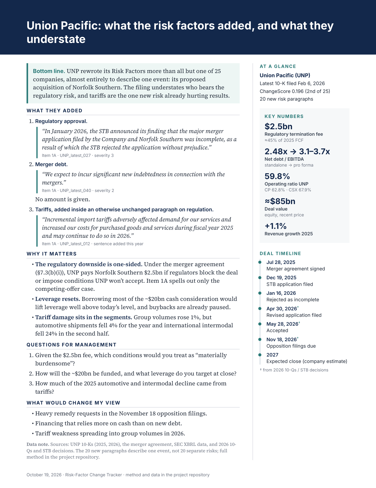
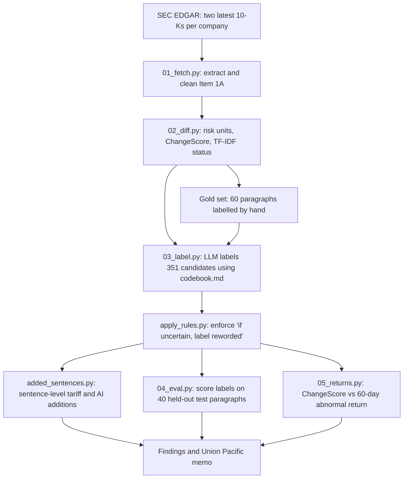
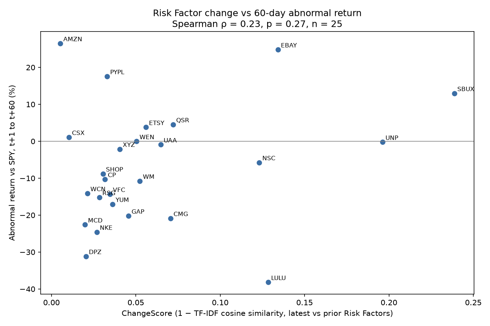

# Risk-Factor Change Tracker

This project compares the two most recent annual reports (Form 10-K) of 25 North American companies to find what changed in their "Risk Factors" sections, using TF-IDF similarity to locate changed text and an LLM following a written codebook to separate new risks from rewording. It checks those labels against 60 hand-labelled paragraphs, counts language added at sentence level, tests for a link to stock returns, and ends with a one-page analyst memo on Union Pacific.

## Key findings

1. **Most risk language is copied forward:** 80% of this year's risk paragraphs (1,408 of 1,759) closely match last year's, and of the 351 that changed, 54 (15%) were judged genuinely new, from 15 of the 25 companies.
2. **Mergers are the largest source of new risks:** 30 of the 54 are about mergers, acquisitions or divestitures, and 26 of those come from Union Pacific (18) and Norfolk Southern (8) describing their planned merger.
3. **Tariffs grew inside existing risks:** no company added a new tariff risk paragraph, but 59 new sentences mentioning tariffs appear across 15 of the 25 companies.
4. **AI appears both ways:** 9 companies wrote a genuinely new risk paragraph that mentions AI, and 19 of the 25 added at least one new sentence about AI.
5. **The LLM labels held up:** on 40 hand-labelled test paragraphs it found 6 of the 7 genuinely new risks with no false alarms (6 of 6), against 47% precision (7 of 15) for the text-similarity screen alone, and all 40 supporting quotes appear in the filing.

Source file and filter for each number: [FINDINGS.md](FINDINGS.md). Confidence intervals: [Evaluation](#evaluation).

**Contents:** [Analyst memo](#analyst-memo-union-pacific) · [Objective](#objective) · [Data and scope](#data-and-scope) · [Method](#method) · [Evaluation](#evaluation) · [Results](#results) · [Conclusions](#conclusions) · [Limitations](#limitations) · [Repository structure](#repository-structure) · [How to run](#how-to-run) · [License](#license)

## Analyst memo: Union Pacific

Union Pacific was chosen on its disclosures, not its stock performance: it has the second-highest change score of the 25 companies (0.196) and the most genuinely new risks (20).

<a href="docs/memo_preview.png"></a>

[Download PDF](output/memo.pdf) · Memo dated October 19, 2026

<details><summary>Memo text</summary>

### Union Pacific: what the risk factors added, and what they understate

**Bottom line.** UNP rewrote its Risk Factors more than all but one of 25 companies, almost entirely to describe one event: its proposed acquisition of Norfolk Southern. The filing understates who bears the regulatory risk, and tariffs are the one new risk already hurting results.

**What they added**
1. Regulatory approval. "In January 2026, the STB announced its finding that the major merger application filed by the Company and Norfolk Southern was incomplete, as a result of which the STB rejected the application without prejudice."
2. Merger debt. "We expect to incur significant new indebtedness in connection with the mergers." No amount is given.
3. Tariffs, added inside an otherwise unchanged paragraph on regulation. "Incremental import tariffs adversely affected demand for our services and increased our costs for purchased goods and services during fiscal year 2025 and may continue to do so in 2026."

**Why it matters**
- The regulatory downside is one-sided. Under the merger agreement (§7.3(b)(i)), UNP pays Norfolk Southern $2.5bn if regulators block the deal or impose conditions UNP won't accept. Item 1A spells out only the competing-offer case.
- Leverage resets. Borrowing most of the ~$20bn cash consideration would lift leverage well above today's level, and buybacks are already paused.
- Tariff damage sits in the segments. Group volumes rose 1%, but automotive shipments fell 4% for the year and international intermodal fell 24% in the second half.

**Questions for management**
1. Given the $2.5bn fee, which conditions would you treat as "materially burdensome"?
2. How will the ~$20bn be funded, and what leverage do you target at close?
3. How much of the 2025 automotive and intermodal decline came from tariffs?

**What would change my view**
- Heavy remedy requests in the November 18 opposition filings.
- Financing that relies more on cash than on new debt.
- Tariff weakness spreading into group volumes in 2026.

**Data note.** Sources: UNP 10-Ks (2025, 2026), the merger agreement, SEC XBRL data, and 2026 10-Qs and STB decisions. The 20 new paragraphs describe one event, not 20 separate risks; full method in the project repository.

</details>

---

## Objective

**Question:** when companies update the risk disclosures in their annual reports, what is actually new, and can the new material be separated reliably from rewording?

**Why it matters:** Item 1A is where a company tells investors what could hurt its business. Most of the text is carried forward from year to year, so what changes is easy to miss and may carry information. Cohen, Malloy and Nguyen ("Lazy Prices", *Journal of Finance*, 2020) found that companies that change their filings go on to underperform companies that do not, and that changes to risk factors are among the changes that carry information about future returns.

## Data and scope

- **Source:** Form 10-K filings from [SEC EDGAR](https://www.sec.gov/edgar), downloaded with [edgartools](https://github.com/dgunning/edgartools).
- **Filings compared:** the two most recent 10-Ks for each company, 50 filings in total. Amendments (10-K/A) are excluded.
- **Filing dates:** latest filings run from 2025-11-14 to 2026-07-15, prior filings from 2024-11-20 to 2025-07-17 (`pipeline/data/tariff_mentions.csv`).
- **Comparison:** one year-over-year pair per company. Filings are labelled `latest` and `prior` rather than by fiscal year, because several companies label fiscal years differently.
- **Companies:** 5 Canadian 10-K filers and 20 US peers.

| Ticker | Company | Industry group | Canadian 10-K filer |
|---|---|---|---|
| UNP | Union Pacific Corporation | Rail |  |
| CSX | CSX Corporation | Rail |  |
| NSC | Norfolk Southern Corporation | Rail |  |
| CP | Canadian Pacific Kansas City Limited | Rail | Yes |
| MCD | McDonald's Corporation | Restaurants |  |
| YUM | Yum! Brands, Inc. | Restaurants |  |
| DPZ | Domino's Pizza, Inc. | Restaurants |  |
| WEN | The Wendy's Company | Restaurants |  |
| CMG | Chipotle Mexican Grill, Inc. | Restaurants |  |
| SBUX | Starbucks Corporation | Restaurants |  |
| QSR | Restaurant Brands International Inc. | Restaurants | Yes |
| WM | Waste Management, Inc. | Waste |  |
| RSG | Republic Services, Inc. | Waste |  |
| WCN | Waste Connections, Inc. | Waste | Yes |
| NKE | NIKE, Inc. | Apparel |  |
| GAP | Gap Inc. | Apparel |  |
| UAA | Under Armour, Inc. | Apparel |  |
| VFC | V.F. Corporation | Apparel |  |
| LULU | lululemon athletica inc. | Apparel | Yes |
| AMZN | Amazon.com, Inc. | E-commerce/payments |  |
| EBAY | eBay Inc. | E-commerce/payments |  |
| ETSY | Etsy, Inc. | E-commerce/payments |  |
| PYPL | PayPal Holdings, Inc. | E-commerce/payments |  |
| XYZ | Block, Inc. | E-commerce/payments |  |
| SHOP | Shopify Inc. | E-commerce/payments | Yes |

## Method



1. **Fetch (`01_fetch.py`).** Downloads each 10-K and extracts Item 1A with edgartools. Shopify's two filings needed a fallback that slices the text from the "Item 1A" heading to the next item heading, because edgartools returned no Item 1A for them.
2. **Clean (`01_fetch.py`).** Removes page footers, page numbers and "Table of Contents" lines, and rejoins sentences split by page breaks. Without this, page breaks create fake paragraph splits and year-specific footers create fake changes.
3. **Risk units (`02_diff.py`).** Groups the text into risk units: a short headline joins the paragraph after it, bullets and continuations attach to the unit before them, and Risk Factors Summary sections are excluded so risks are not counted twice. Units under 200 characters are dropped, except headlines with no body of 60 or more characters. This gives 1,759 latest units and 1,767 prior units.
4. **ChangeScore and status (`02_diff.py`).**
   - **ChangeScore** is 1 minus the TF-IDF cosine similarity between a company's latest and prior Risk Factors. Higher means more change. No LLM is involved.
   - **Status** compares each latest unit with every prior unit of the same company and takes the best match: `kept` at 0.80 or above, `modified` from 0.50 to below 0.80, `new` below 0.50. Prior units with no match of 0.50 or above are `deleted`.
   - Result: 1,408 kept, 193 modified, 158 new, 168 deleted. Status is used only to find candidates. An eyeball check found that of 9 "new" examples, 4 were genuinely new and 5 were rewrites or split paragraphs.
5. **LLM labelling (`03_label.py`, `codebook.md`).** The 351 `new` and `modified` paragraphs go to `claude-sonnet-5-5` with the full codebook (v1.3), the current paragraph and its three closest prior-year matches. The model returns a category, novelty (`genuinely_new` or `reworded`), severity, whether AI is mentioned, a reason, and one supporting sentence copied from the paragraph. `apply_rules.py` then enforces the codebook rule "if uncertain about novelty, label reworded". This changed 3 rows, taking the count of genuinely new paragraphs from 57 to 54.
6. **Sentence-level analysis (`added_sentences.py`).** Paragraph matching misses sentences inserted into paragraphs that still score as `kept`, and those paragraphs never reach the LLM. This step compares every latest sentence with every prior sentence of the same company (rapidfuzz ratio). A sentence is "added" if its best match scores below 85. It counts as a new tariff or AI mention only if its closest prior sentence has no tariff or AI term. This step uses no LLM.
7. **Evaluation (`04_eval.py`).** Scores the LLM against the hand labels on the held-out test set. See [Evaluation](#evaluation).
8. **Returns test (`05_returns.py`).** Computes each stock's return from the close of the first trading day after filing to the close of the 60th, minus the SPY return over the same dates. It then takes the Spearman rank correlation with ChangeScore (primary) and with the count of genuinely new risks (secondary). Both statistics were fixed in advance.

The reasoning behind each choice is logged in [DECISIONS.md](DECISIONS.md).

## Evaluation

**Gold set.** 60 paragraphs were sampled from the `new` and `modified` candidates (seed 42, at most 3 per company) and labelled by hand under the codebook. TF-IDF status and similarity were hidden during labelling. The set was split into 20 development rows and 40 test rows, stratified by novelty, before any LLM output existed. The labels were then frozen and their hash recorded in `pipeline/data/gold_labels.sha256`. They were not changed after LLM output was seen.

**Model choice.** This was decided on the development rows only. Haiku found 0 of 4 genuinely new risks (1 on a rerun). Sonnet found 3 of 4, with higher category agreement (18/20 vs 14/20).

**Test results.** All figures are from `pipeline/data/eval_results.json` (the `final` key). Intervals are 95% Wilson score intervals. Full detail is in [eval_report.md](pipeline/data/eval_report.md).

| Metric | Result | Count | 95% CI |
|---|---|---|---|
| Category accuracy | 85.0% | 34/40 | 70.9–92.9% |
| Novelty precision (genuinely new) | 100.0% | 6/6 | 61.0–100.0% |
| Novelty recall (genuinely new) | 85.7% | 6/7 | 48.7–97.4% |
| Novelty F1 | 0.92 | | |
| Severity, exact | 64.1% | 25/39 | 48.4–77.3% |
| Severity, within one level | 97.4% | 38/39 | 86.8–99.5% |
| AI mention agreement | 95.0% | 38/40 | 83.5–98.6% |
| Supporting quote found in the paragraph | 100.0% | 40/40 | 91.2–100.0% |

**Baseline comparison (novelty, 39 test rows the human labelled as a risk, 7 genuinely new).**

| Method | Precision | Recall | F1 | Agreement |
|---|---|---|---|---|
| LLM (final) | 6/6 (100.0%) | 6/7 (85.7%) | 0.92 | 38/39 (97.4%) |
| TF-IDF only (status = `new`) | 7/15 (46.7%) | 7/7 (100.0%) | 0.64 | 31/39 (79.5%) |
| Always "reworded" | n/a (0/0) | 0/7 (0.0%) | n/a | 32/39 (82.1%) |

Agreement is not the headline metric, because always answering "reworded" already scores 82.1%. TF-IDF alone catches every new risk but more than half of its flags are false alarms. The LLM removes those false alarms and misses one.

**Quote verification.** Each label must include one sentence copied from the paragraph. Code checks that the sentence appears there after normalising whitespace, quotes and dashes. All 40 test quotes passed, and so did all 351 quotes in the full run (`pipeline/data/llm_labels_all_v1_sonnet_final.csv`, column `quote_valid`). This shows the quote exists. It does not show the label is right.

**Effect of the uncertainty rule.** Before `apply_rules.py`, the test run scored 7/7 on both precision and recall. The rule changed one test row, `MCD_latest_035`, which the model had labelled genuinely new while flagging itself uncertain. It became `reworded`, which is the single miss above.

**Stability.** The test set was labelled twice and only the first run is scored. Agreement between the two runs: category 37/40 (92.5%), novelty 39/40 (97.5%), severity 34/40 (85.0%), AI mention 40/40 (100.0%).

**Disputed labels.** The headline numbers above are strict. Two test rows were recorded as debatable during error review, after scoring. Dropping them moves category accuracy to 34/39 (87.2%) and AI mention agreement to 38/39 (97.4%). Other metrics do not change.

## Results

### ChangeScore ranking

Higher means more change. Latest and Prior are total risk units in each filing, and New to Deleted are their TF-IDF statuses. "Genuinely new" is the LLM label after the uncertainty rule. Source: `pipeline/data/change_scores.csv`, `pipeline/data/llm_labels_all_v1_sonnet_final.csv`.

| # | Ticker | Score | Latest | Prior | New | Modified | Kept | Deleted | Genuinely new |
|---:|---|---:|---:|---:|---:|---:|---:|---:|---:|
| 1 | SBUX | 0.239 | 62 | 66 | 31 | 23 | 8 | 36 | 1 |
| 2 | UNP | 0.196 | 44 | 23 | 21 | 0 | 23 | 0 | 20 |
| 3 | EBAY | 0.134 | 95 | 102 | 23 | 42 | 30 | 33 | 1 |
| 4 | LULU | 0.128 | 70 | 71 | 12 | 9 | 49 | 12 | 2 |
| 5 | NSC | 0.123 | 47 | 41 | 9 | 0 | 38 | 3 | 8 |
| 6 | QSR | 0.072 | 55 | 62 | 0 | 5 | 50 | 6 | 0 |
| 7 | CMG | 0.071 | 43 | 45 | 5 | 2 | 36 | 7 | 2 |
| 8 | UAA | 0.065 | 62 | 63 | 3 | 6 | 53 | 5 | 1 |
| 9 | ETSY | 0.056 | 143 | 149 | 16 | 11 | 116 | 21 | 5 |
| 10 | WM | 0.052 | 75 | 89 | 1 | 19 | 55 | 11 | 0 |
| 11 | WEN | 0.050 | 59 | 56 | 3 | 11 | 45 | 2 | 1 |
| 12 | GAP | 0.046 | 66 | 65 | 5 | 8 | 53 | 4 | 2 |
| 13 | XYZ | 0.040 | 137 | 128 | 13 | 11 | 113 | 5 | 7 |
| 14 | YUM | 0.036 | 68 | 72 | 2 | 9 | 57 | 4 | 1 |
| 15 | VFC | 0.035 | 83 | 82 | 3 | 5 | 75 | 3 | 0 |
| 16 | PYPL | 0.033 | 72 | 72 | 3 | 4 | 65 | 3 | 1 |
| 17 | CP | 0.032 | 49 | 51 | 1 | 5 | 43 | 2 | 0 |
| 18 | SHOP | 0.031 | 115 | 119 | 2 | 2 | 111 | 6 | 1 |
| 19 | RSG | 0.028 | 54 | 54 | 1 | 2 | 51 | 1 | 0 |
| 20 | NKE | 0.027 | 77 | 78 | 0 | 5 | 72 | 1 | 1 |
| 21 | WCN | 0.021 | 75 | 78 | 0 | 3 | 72 | 2 | 0 |
| 22 | DPZ | 0.020 | 67 | 63 | 1 | 9 | 57 | 0 | 0 |
| 23 | MCD | 0.020 | 54 | 52 | 2 | 1 | 51 | 0 | 0 |
| 24 | CSX | 0.010 | 38 | 37 | 1 | 1 | 36 | 1 | 0 |
| 25 | AMZN | 0.005 | 49 | 49 | 0 | 0 | 49 | 0 | 0 |

ChangeScore and genuinely new risks do not always agree. Starbucks ranks first with 1 genuinely new risk, because most of its change is restructuring and rewording.

### New risks by category

| Category | Genuinely new | All candidates |
|---|---:|---:|
| M&A/transactions | 30 | 41 |
| AI/tech | 13 | 33 |
| credit/liquidity | 3 | 27 |
| regulation/legal | 3 | 87 |
| other | 4 | 84 |
| cyber/data privacy | 1 | 10 |
| tariffs/trade | 0 | 19 |
| competition | 0 | 23 |
| macro | 0 | 22 |
| not_a_risk | 0 | 5 |
| **Total** | **54** | **351** |

"All candidates" also includes paragraphs labelled `reworded`, and 5 labelled `not_a_risk`, which have no novelty label. Source: `pipeline/data/llm_labels_all_v1_sonnet_final.csv`.

### Tariff and AI sentences

The sentence comparison found 1,638 added sentences. A "new mention" meets the stricter test: the sentence mentions the theme and its closest prior sentence does not. This means a new sentence on the topic, not a company's first-ever disclosure of it.

| Theme | Added sentences mentioning it | New mentions | Companies with a new mention | New mentions inside `kept` paragraphs |
|---|---:|---:|---:|---:|
| Tariffs | 80 | 59 | 15 | 13 |
| AI | 143 | 109 | 19 | 35 |

New mentions by company (companies with none are omitted). Source: `pipeline/data/added_by_ticker.csv`.

| Ticker | New tariff mentions | New AI mentions |
|---|---:|---:|
| LULU | 14 | 6 |
| EBAY | 9 | 13 |
| GAP | 8 | 7 |
| SBUX | 6 | 3 |
| UNP | 5 | 0 |
| UAA | 4 | 6 |
| ETSY | 3 | 18 |
| XYZ | 2 | 20 |
| YUM | 2 | 3 |
| QSR | 1 | 2 |
| VFC | 1 | 2 |
| CMG | 1 | 1 |
| WM | 1 | 1 |
| CP | 1 | 0 |
| PYPL | 1 | 0 |
| NKE | 0 | 6 |
| AMZN | 0 | 5 |
| MCD | 0 | 4 |
| RSG | 0 | 4 |
| SHOP | 0 | 4 |
| WCN | 0 | 2 |
| WEN | 0 | 2 |

### Returns test

All 25 companies had a complete 60-day window. Source: `pipeline/data/returns.csv`.

| Test | Spearman ρ | p-value | n |
|---|---:|---:|---:|
| ChangeScore vs abnormal return (primary) | 0.23 | 0.27 | 25 |
| Genuinely new risk count vs abnormal return (secondary) | 0.04 | 0.84 | 25 |



**Neither test shows a detectable relationship, and this sample could not have shown one unless it were strong.** The reasons:

- **Too few observations for a modest effect.** With n = 25, a Spearman correlation must reach about 0.40 in size to be significant at the 5% level. A rough 95% interval around the observed 0.23 runs from about −0.2 to 0.6, which covers a meaningful negative effect, no effect and a large positive effect. A true correlation of about 0.5 would be needed for 80% statistical power.
- **Returns are noisy.** Abnormal returns in this sample range from −38% to +26%. Earnings, deals and market moves over 60 trading days can easily swamp any effect of a disclosure change.
- **One cross-section.** This is a single year of filings from selected industries. "Lazy Prices" studied a large multi-year panel of filers using portfolios, which is a far more powerful design. This test is not a replication of it.

The result therefore does not show that risk-factor changes are unrelated to returns. It shows only that a test of this size cannot tell. The observed sign is positive, the opposite of the "Lazy Prices" direction, but it is not distinguishable from zero.

## Conclusions

**What the results show**

- For these 25 companies and this pair of years, most Risk Factors text carries forward nearly unchanged.
- A text-similarity screen alone is not enough to find new risks. On the test set fewer than half of its `new` flags were genuinely new. An LLM following a written codebook removed those false alarms while keeping most of the true cases.
- Counting new risk paragraphs overstates the number of distinct new risks. 28 of the 54 describe one merger: the 26 Union Pacific and Norfolk Southern paragraphs in the M&A category, plus 2 Union Pacific paragraphs on combined-company debt covenants that are categorised as credit/liquidity.
- Paragraph-level and sentence-level views give different answers. Tariffs produced no new paragraph-level risk but did produce new sentences at 15 companies. Using both views matters.

**What the results do not show**

- They do not describe companies in general. The sample is small, chosen by industry, and covers one pair of years.
- They do not show whether risk-factor changes predict returns. The returns test is too small to tell.
- They do not establish how much a new risk matters to a company. Novelty and severity are text judgments, not measured business impact.
- They do not show that a new sentence is a first-ever disclosure. Several companies already discussed tariffs the year before.
- They do not prove the LLM is 100% precise. The 6/6 result has a 95% interval that starts at 61.0%.

## Limitations

**Sample**

- 25 companies and one pair of years. The findings describe these filings only.
- Companies were selected by industry, not at random.

**Evaluation**

- The test set is small. With 7 genuinely new risks in 40 paragraphs, the 95% interval for recall runs from 48.7% to 97.4%.
- The gold set was sampled only from `new` and `modified` candidates, so the evaluation cannot measure risks hidden in `kept` paragraphs, which never reach the LLM. The sentence-level step was added to address this.
- The uncertainty rule was enforced on 2026-10-18, after the test set was labelled on 2026-10-15. Enforcing it lowered the measured recall from 7/7 to 6/7. Raw and rule-applied numbers are both reported.
- Severity is the weakest field, with exact agreement of 64.1%.
- Labels are not deterministic, because the models used reject a custom temperature and run at the API default. Run-to-run stability is reported above. The one novelty disagreement between the two final test runs is `VFC_latest_079`, labelled `not_a_risk` in one run and `reworded` in the other. In the raw runs `MCD_latest_035` also differed, with the model flagging itself uncertain both times, and error review judged that row genuinely ambiguous.

**Sentence-level counts**

- They use no LLM and have no gold-set evaluation. They were checked by reading random samples only.
- The threshold of 85 cannot fully separate rewording from additions, which is why theme counts use the stricter rule.
- A "new tariff sentence" means a new sentence that mentions tariffs, not a first-ever disclosure.

**Text processing**

- TF-IDF `new` status is noisy. In an eyeball check, 5 of 9 "new" examples were rewrites or split paragraphs. It is used only to find candidates.
- Known grouping quirks were accepted because they affect both years equally: Amazon's title-case headlines land in the section field, Canadian Pacific and Union Pacific put headlines inline, and some short body paragraphs merge with the next paragraph.
- Deleted paragraphs (168) were not analysed. In Starbucks and eBay, most were old versions of rewritten risks, not risks that were dropped.

**Returns**

- See [Returns test](#returns-test). Filing dates differ by company, so the 60-day windows do not line up, and the test says nothing about cause and effect.

**Memo**

- The 20 new Union Pacific paragraphs describe one event, not 20 separate risks.
- Pro forma leverage in `output/model.xlsx` is illustrative. It excludes synergies, transaction costs, divestitures, and cash generated or debt repaid before closing.
- Canadian Pacific reports in CAD, so its ratios are comparable but its levels are not.
- Timeline items marked † in the memo come from 2026 10-Qs and STB decisions, which are not stored in this repository.

## Repository structure

```text
├── README.md
├── LICENSE
├── FINDINGS.md                       Findings, each with its source file and filter
├── DECISIONS.md                      Dated log of methodology decisions
├── codebook.md                       Labelling rules used by the human labeller and the LLM (v1.3)
├── docs/
│   └── memo_preview.png              Preview image of the memo
├── output/
│   ├── memo.pdf                      One-page Union Pacific memo
│   ├── memo.md                       Memo text
│   ├── model.xlsx                    Financials and illustrative pro forma leverage
│   ├── unp_reading_pack.md           Source passages used for the memo
│   └── charts/
│       └── returns_vs_changescore.png
└── pipeline/
    ├── .env.example                  Environment variable names
    ├── requirements.txt
    ├── src/
    │   ├── 01_fetch.py               Download 10-Ks, extract and clean Item 1A
    │   ├── 02_diff.py                Risk units, ChangeScore, TF-IDF status, gold sample
    │   ├── 03_label.py               LLM labelling
    │   ├── apply_rules.py            Enforce the uncertainty rule, write *_final.csv
    │   ├── 04_eval.py                Score LLM labels against the gold set
    │   ├── added_sentences.py        Sentence-level tariff and AI additions
    │   ├── 05_returns.py             Abnormal returns and Spearman tests
    │   ├── memo_financials.py        Build output/model.xlsx
    │   ├── memo_reading_pack.py      Build output/unp_reading_pack.md
    │   └── render_memo.py            Render output/memo.pdf
    └── data/
        ├── paragraphs.csv            All risk units with status and top matches
        ├── change_scores.csv         ChangeScore and status counts by company
        ├── gold_labels.xlsx          60 hand-labelled paragraphs (frozen)
        ├── gold_labels.sha256        Hash of the frozen gold sheet
        ├── gold_meta.csv             TF-IDF status for gold rows, hidden during labelling
        ├── gold_disputes.csv         Debatable gold labels (gold sheet not changed)
        ├── llm_labels_*.csv          LLM labels per run, raw and *_final
        ├── llm_runs/*.jsonl          Log of every API call, with token usage
        ├── eval_results.json         All evaluation metrics
        ├── eval_report.md            Readable evaluation report
        ├── eval_errors.xlsx          Error review sheet
        ├── added_sentences.csv       One row per added sentence
        ├── added_by_ticker.csv       Added sentence counts by company
        ├── tariff_mentions.csv       Tariff term counts and filing dates by company
        ├── returns.csv               Abnormal returns by company
        └── unp_*.txt                 Union Pacific MD&A, Note 20 and merger agreement text
```

`pipeline/data/filings.db` holds the downloaded filing text. It is not in the repository and is rebuilt by `01_fetch.py`.

## How to run

The outputs in this repository are final, and every number in this README comes from them. Re-running is optional and overwrites them. `01_fetch.py` always takes the two most recent 10-Ks, and prices are downloaded fresh, so a new run can give different results once newer filings exist.

**Setup** (developed on Python 3.12.4)

```bash
cd pipeline
python3 -m venv .venv
source .venv/bin/activate
pip install -r requirements.txt
cp .env.example .env          # then set ANTHROPIC_API_KEY
```

- `render_memo.py` needs Pango (macOS: `brew install pango`).
- The SEC requires a contact identity on requests. Replace the `set_identity(...)` value in `01_fetch.py`, `memo_financials.py` and `memo_reading_pack.py` with your own name and email.

**Script order** (run from `pipeline/`)

| Step | Command | Reads | Writes |
|---:|---|---|---|
| 1 | `python src/01_fetch.py` | SEC EDGAR | `data/filings.db` |
| 2 | `python src/02_diff.py` | `data/filings.db` | `data/paragraphs.csv`, `data/change_scores.csv` |
| 3 | `python src/03_label.py --dev` | gold sheet, `codebook.md` | `data/llm_labels_dev_*.csv`, `data/llm_runs/` |
| 4 | `python src/03_label.py --test --confirm-test` | gold sheet, `codebook.md` | `data/llm_labels_test_*.csv`, `data/llm_runs/` |
| 5 | `python src/03_label.py --all` | `data/paragraphs.csv`, `codebook.md` | `data/llm_labels_all_*.csv`, `data/llm_runs/` |
| 6 | `python src/apply_rules.py` | `data/llm_labels_*.csv` | `data/llm_labels_*_final.csv` |
| 7 | `python src/04_eval.py` | gold sheet, labels, `gold_meta.csv`, `gold_disputes.csv`, `eval_errors.xlsx` | `data/eval_results.json`, `data/eval_report.md` |
| 8 | `python src/added_sentences.py` | `data/paragraphs.csv`, final labels | `data/added_sentences.csv`, `data/added_by_ticker.csv` |
| 9 | `python src/05_returns.py` | `data/filings.db`, `data/change_scores.csv`, final labels, Yahoo Finance prices | `data/returns.csv`, `output/charts/*.png` |
| 10 | `python src/memo_financials.py` | SEC XBRL data, Yahoo Finance prices | `output/model.xlsx` |
| 11 | `python src/memo_reading_pack.py` | `data/filings.db`, pipeline outputs, `data/unp_mdna_latest.txt` | `output/unp_reading_pack.md` |
| 12 | `python src/render_memo.py` | `output/memo.md`, `output/model.xlsx` | `output/memo.pdf` |

Notes:

- `03_label.py` skips paragraphs already present in the output CSV, so it makes no API calls for the committed runs unless you pass `--force`. It still needs the key in `.env`.
- The second test run was made with `--test --confirm-test --run-name test_v1_sonnet_rep2`. The Haiku comparison used `--dev --model claude-haiku-5-5`.
- `02_diff.py --gold` samples a new gold set. It refuses to run while the labelled sheet exists. Hand labelling is a manual step, and `gold_labels.xlsx` is frozen by hash.
- Steps 6 to 8 need no network and no `filings.db`, so they can be run straight after cloning.

**Approximate API cost.** The full run (351 paragraphs, 353 API calls) used 627,328 input tokens, 171,525 output tokens, 3,037,408 cache-read tokens and 8,629 cache-write tokens. All seven logged runs together used 513 calls. Applying Anthropic's list prices to those token counts gives about $3.60 for the full run and about $4.85 for all seven. Token counts are from `pipeline/data/llm_runs/*.jsonl`. Prices were Sonnet 5.5 at $2 / $10 per million input / output tokens and Haiku 5.5 at $0.10 / $0.50, with cache reads at 0.1× and cache writes at 1.25× the input price. The pre-run projection in `DECISIONS.md` was about $4 for the full run. Prices can change, and the logs do not record billed amounts.

## License

The code is released under the [MIT License](LICENSE). SEC filings are public data. Stock prices used for the returns test and the memo come from Yahoo Finance via yfinance and are subject to its terms.
